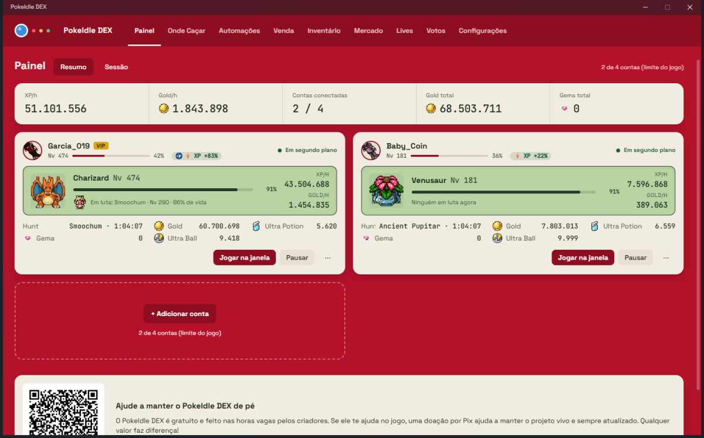
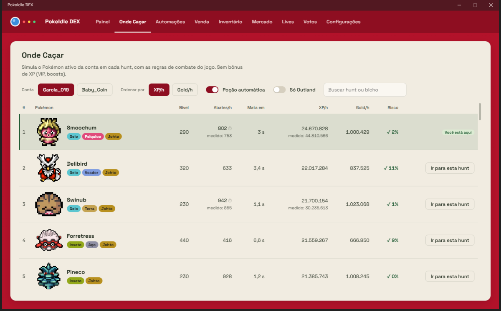
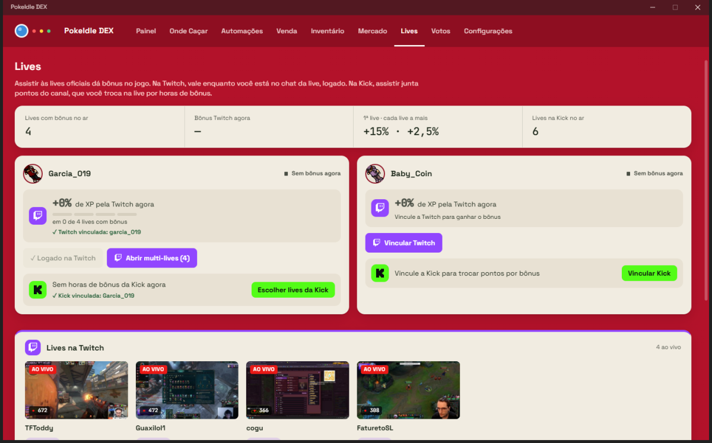
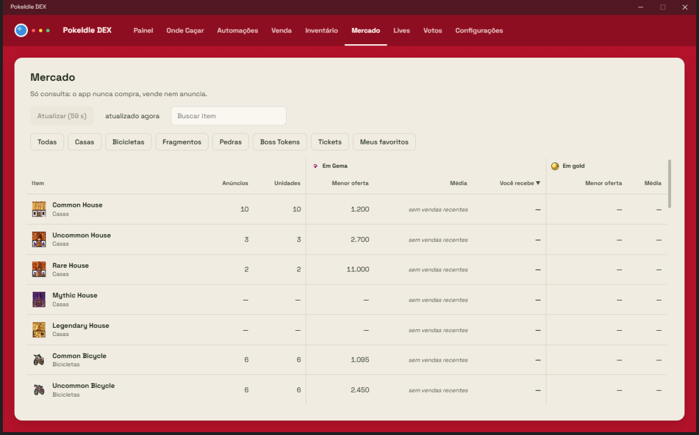

# PokeIdle DEX

App de Windows para o **pokeidle.io**: suas contas (até 4) rodando juntas em segundo plano, onde caçar, mercado,
automações e os bônus de lives da Twitch e da Kick, tudo num lugar só.

**[⬇️ Baixar a versão mais nova](https://github.com/Garcia019/pokeidle-dex-releases/releases/latest)** · Windows 10/11 · grátis · **[🌐 Site do app](https://garcia019.github.io/pokeidle-dex-releases/)**

## O que ele faz

- **Painel:** todas as contas ao vivo, com XP/h, gold/h, Pokémon em luta e itens.
- **Onde Caçar:** simula o seu Pokémon em cada hunt, com as regras de combate do jogo, e mostra onde rende mais XP ou gold.
- **Automações:** compra e venda automática e o que mais o jogo permite automatizar.
- **Inventário e Mercado:** itens, Pokémon e preços do mercado, só para consulta.
- **Lives:** multi-lives da Twitch numa janela só e até 2 lives da Kick, que trocam sozinhas quando uma acaba.
- **Votos:** votar no TopIdle com cada conta.
- **Jogar na janela:** abre o jogo com a conta já logada.
- Atualiza sozinho.

| Onde Caçar | Lives |
|---|---|
|  |  |

## Seguro de verdade

- **Sua senha nunca passa pelo app.** O login é feito na página oficial do jogo e o app guarda só a sessão, no cofre de credenciais do Windows.
- **Nunca burla o captcha** e nunca deixa passar de 4 contas, o limite do jogo.
- **Seus dados não saem do seu PC**, a não ser para o próprio jogo. O app só consulta aqui se há versão nova, sem mandar nada das suas contas.
- **Atualizações assinadas:** o app recusa qualquer atualização sem a assinatura do projeto.

## Como instalar

1. Baixe o `PokeIdle.DEX_x.y.z_x64-setup.exe` em **[Releases](https://github.com/Garcia019/pokeidle-dex-releases/releases/latest)**.
2. Abra o instalador. Se o Windows mostrar "O Windows protegeu o computador", clique em **Mais informações › Executar assim mesmo**. O aviso aparece porque o instalador ainda não tem certificado pago da Microsoft.
3. Clique em **Adicionar conta** e entre como no site do jogo.

## Apoie o projeto

O PokeIdle DEX é gratuito e feito nas horas vagas. Se ele te ajuda, um Pix de qualquer valor ajuda a mantê-lo vivo e atualizado.

Chave Pix (aleatória): `59b3446c-cfdb-4d0e-8760-532733ab174f`

## Criadores

Feito por **[Garcia019](https://github.com/Garcia019)** (Matheus) e **Luxca** (Lucas).

---

Este repositório guarda só os instaladores e o `latest.json` que o app consulta para se atualizar. Licença GPL-3.0. Pokémon e pokeidle.io pertencem aos seus donos.
